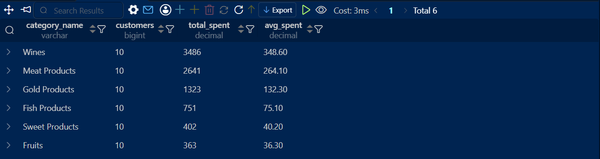
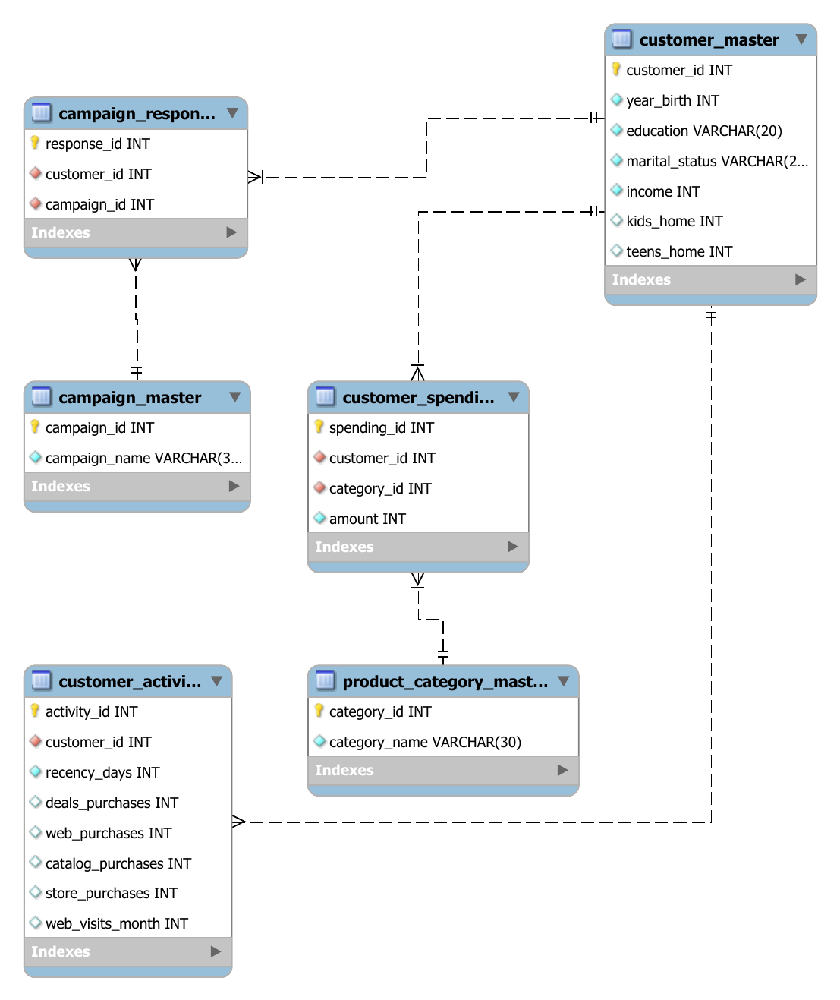

# Customer Loyalty & Churn-Risk Tracker
### A normalized MySQL database and seven SQL queries to find customers at risk of leaving

A small relational database (3NF) holding 30 sample customers, their buying behaviour, their spending in each product category and their response to marketing campaigns. INNER JOIN queries with WHERE, GROUP BY and HAVING answer practical business questions, such as *which customers have stopped buying but still visit the website?*

DBMS mini project, PGDM at IILM, New Delhi. Built with **MySQL 8.x** and **SQL** (DDL, DML, DQL) in Visual Studio Code.

## Questions the queries answer

| # | Question | Result |
|---|---|---|
| 1 | Which customers have not bought for over 60 days but visit the website more than 6 times a month? | 7 of 30 customers (about 23%) are at risk; customer 1430 has been inactive the longest (98 days) |
| 2 | Which customers earn over 60,000 and spent over 300 on wines? | 12 customers (40%) |
| 3 | Who accepted Campaign 5? | 5 customers |
| 4 | Who accepted the latest campaign and used deals at least twice? | 9 customers |
| 5 | Which families with two or more children at home buy more in store than online? | 4 customers |
| 6 | How much do Master's and PhD customers spend in each category? | Wines and Meat Products are about 68% of their total spending (6,127 of 8,966) |
| 7 | Who earns over 30,000 and accepted at least two campaigns? | 7 customers; customer 1106 accepted 4 campaigns |

The queries are in [`sql/queries.sql`](sql/queries.sql). Screenshots of every result are in [`images/`](images/).



## Database design

Six tables: three master tables (`customer_master`, `product_category_master`, `campaign_master`) and three transaction tables (`customer_activity`, `customer_spending`, `campaign_response`), linked with primary and foreign keys.

- `customer_master` to `customer_activity`: one-to-one
- `customer_master` to `customer_spending`: one-to-many (one row per category)
- `customer_master` to `campaign_master`: many-to-many, resolved by `campaign_response`



The original data was one wide table. Normalization split it up: the six spending columns became rows in `customer_spending`, the campaign columns became rows in `campaign_response`, and totals are calculated with `SUM()` instead of being stored.

Beyond the report, the database also has a view, `customer_summary`. It gives one row per customer with education, income, recency (days since the last purchase), frequency (purchases across all four channels) and monetary value (total spending): the three inputs for RFM analysis. Its definition is in [`sql/views.sql`](sql/views.sql).

## Files

```
sql/
  loyalty_tracker_dump.sql  full export: the six tables, all the data and the view
  schema.sql                the table definitions, as a readable reference
  views.sql                 the customer_summary view
  queries.sql               the seven queries
images/                     ER diagram and query outputs
```

## How to run

1. Install MySQL 8.x and a SQL client (MySQL Workbench, or VS Code with a MySQL extension).
2. Create an empty database: `CREATE DATABASE loyalty_tracker;`
3. Import `sql/loyalty_tracker_dump.sql` into it. In MySQL Workbench use Server, then Data Import. From a terminal: `mysql -u <your user> -p loyalty_tracker < sql/loyalty_tracker_dump.sql`. This creates the six tables, loads the 30 customers and their records, and creates the view.
4. Run the queries in `sql/queries.sql`.

If the import stops with error 1449 about a missing definer, delete the `DEFINER=...` part of the view line in the dump, or skip it and run `sql/views.sql` instead.

## Database design

Six tables: three master tables (`customer_master`, `product_category_master`, `campaign_master`) and three transaction tables (`customer_activity`, `customer_spending`, `campaign_response`), linked with primary and foreign keys.

- `customer_master` to `customer_activity`: one-to-one
- `customer_master` to `customer_spending`: one-to-many (one row per category)
- `customer_master` to `campaign_master`: many-to-many, resolved by `campaign_response`


The original data was one wide table. Normalization split it up: the six spending columns became rows in `customer_spending`, the campaign columns became rows in `campaign_response`, and totals are calculated with `SUM()` instead of being stored.

Beyond the report, the database also has a view, `customer_summary`. It gives one row per customer with education, income, recency (days since the last purchase), frequency (purchases across all four channels) and monetary value (total spending): the three inputs for RFM analysis. Its definition is in [`sql/views.sql`](sql/views.sql).

## Files

```
sql/
  schema.sql    table definitions
  data.sql      the 30 customers and their related records
  queries.sql   the seven queries
images/         ER diagram and query outputs
report/         the full project report (PDF)
```

## How to run

1. Install MySQL 8.x and open a SQL client (MySQL Workbench or VS Code with a MySQL extension).
2. Run `sql/schema.sql`. It creates the `loyalty_tracker` database and the six tables.
3. Run `sql/data.sql` to load the records.
4. Run the queries in `sql/queries.sql`.

## Data

The data is a 30-customer sample adapted from the [Customer Personality Analysis](https://www.kaggle.com/datasets/imakash3011/customer-personality-analysis) dataset on Kaggle. The sample was chosen to be varied (all education levels and marital statuses, some inactive customers, some high spenders). The dataset only records whether a customer accepted each campaign, so the campaign names ("Campaign 1" to "Campaign 5" and "Latest Campaign") are labels created for this project.

## Limitations

- With only 30 sample customers, the results show how the queries work. They are not business conclusions.
- There are no campaign dates or budgets in the data.
- There is no user interface; everything is done through SQL.

## Possible next steps

RFM scoring with window functions on top of `customer_summary`, subqueries that compare customers with averages, stored procedures for inactive customers, triggers for an audit log, and loading the full dataset (over 2,000 customers) into a dashboard.

## Author

Kiran Bhowmik, PGDM 2025-27, IILM Lodhi Road, New Delhi.
